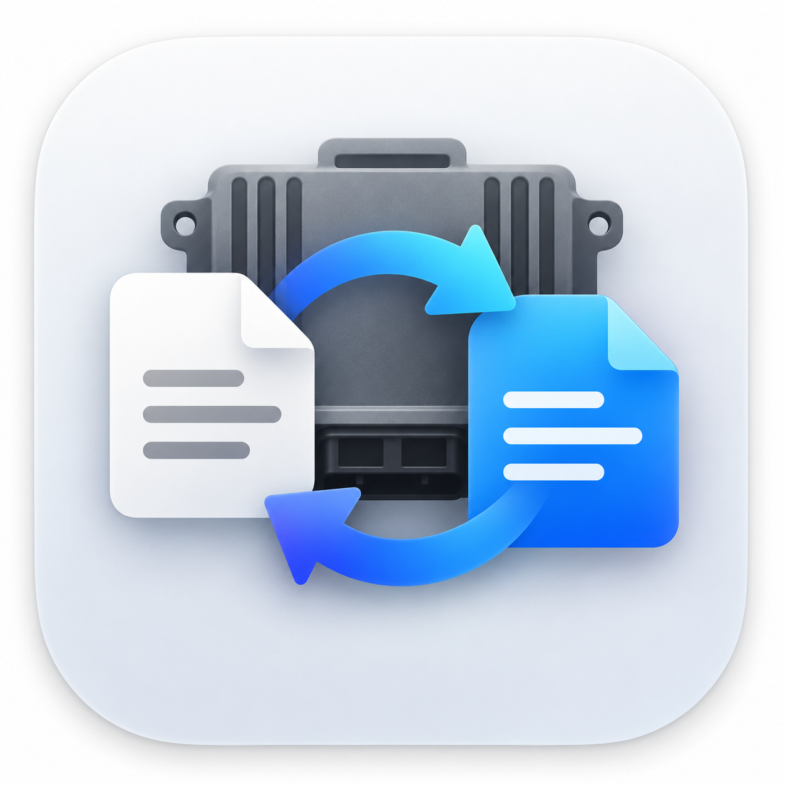

  

<h1 align="center">MSTRO Converter</h1>

A simple desktop utility for converting between MSTRO and BIN files.

## Features

- Convert MSTRO files to BIN files.
- Convert a BIN file to MSTRO using a matching MSTRO file as a template for encryption.
- Repair supported MED9 checksums automatically.
- Available for Windows (64-Bit) and macOS (Apple Silicon).

## Usage
### Convert to BIN
1. Choose **Convert to BIN**
2. Select the MSTRO file you want to convert
3. Set an output location.
4. Start the conversion.

### Convert to MSTRO
1. Choose **Convert to MSTRO**
2. Select the BIN file you want to convert,
3. Select the original MSTRO file before BIN conversion, or any MSTRO file that matches the BIN file's ECU (e.g. 1K0907115H.mstro) if you don't have one.
4. Set an output location.
5. Start the conversion.

## Supported files
Currently Only MED9 is supported, MED7 and others coming soon!

## Warning
Always keep an original backup and a known-good recovery path.
Tested on 1K0907115H
